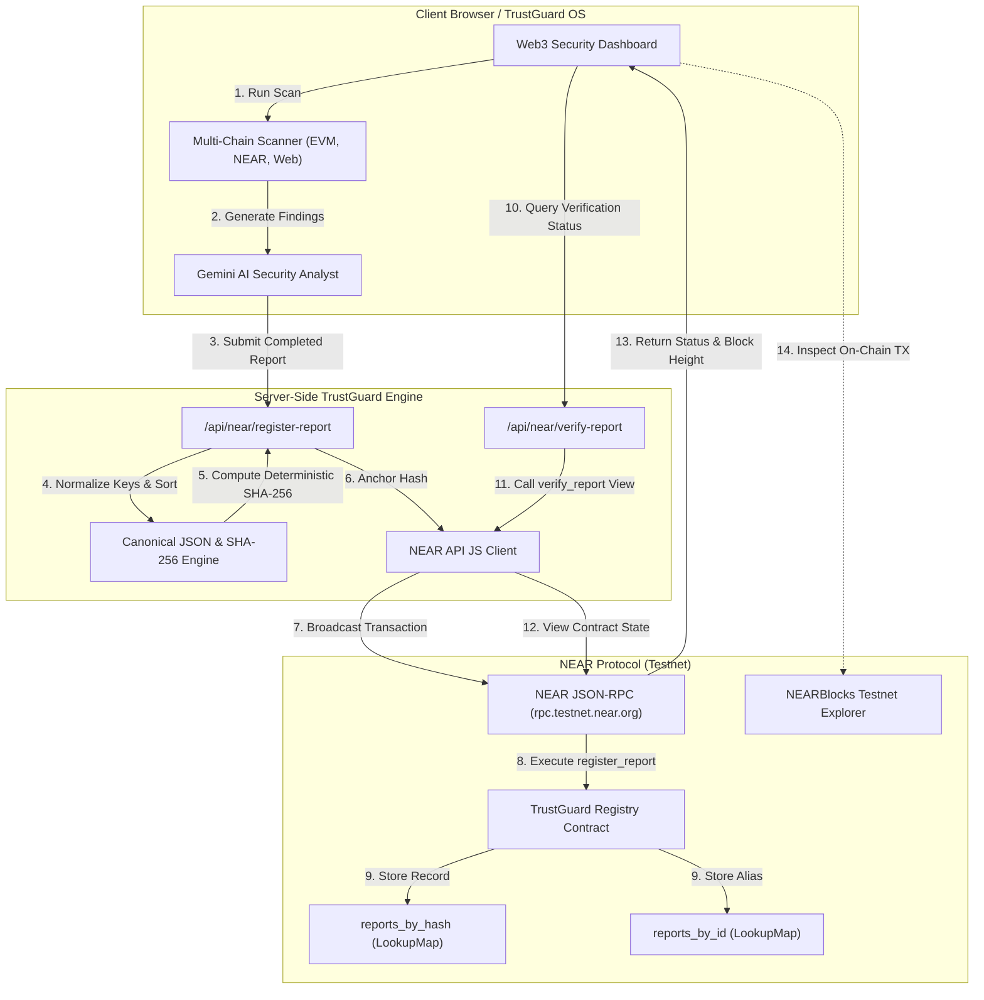

# TrustGuard AI: Blockchain Architecture Specification

This document details the blockchain architecture, cryptographic guarantees, and data flows of **TrustGuard AI**'s report verification engine on the **NEAR Protocol**.

---

## 1. High-Level Architecture Diagram



---

## 2. The Deterministic Canonical Hashing Pipeline

In distributed systems, standard `JSON.stringify(report)` is non-deterministic because JavaScript engines do not guarantee object key order. If two independent nodes serialize identical security reports with different key sequences, they generate completely different SHA-256 hashes.

TrustGuard AI solves this with **Canonical Recursive Key Sorting**:

### Pipeline Implementation (`src/lib/near-hashing.ts`):
1. **Sanitization**: Remove ephemeral, transient timestamps (`clientRenderTime`, `uiAnimationIndex`) that are non-deterministic.
2. **Recursive Sorting**: All object keys are sorted lexicographically in alphabetical order:
   ```typescript
   export function canonicalStringify(obj: unknown): string {
     if (obj === null || typeof obj !== "object") {
       return JSON.stringify(obj);
     }
     if (Array.isArray(obj)) {
       return "[" + obj.map((item) => canonicalStringify(item)).join(",") + "]";
     }
     const keys = Object.keys(obj as Record<string, unknown>).sort();
     const entries = keys.map(
       (k) => `${JSON.stringify(k)}:${canonicalStringify((obj as Record<string, unknown>)[k])}`
     );
     return "{" + entries.join(",") + "}";
   }
   ```
3. **SHA-256 Digest**: The sorted string is hashed using Node.js `crypto.createHash("sha256")`:
   $$\text{ReportHash} = \text{SHA256}(\text{CanonicalJSON}(\text{ReportPayload}))$$
4. **Validation**: All hashes must strictly match the 64-character hexadecimal format `/^[a-f0-9]{64}$/i`.

---

## 3. On-Chain vs. Off-Chain Data Segregation

To ensure maximum privacy, minimal gas fees, and compliance with data minimization best practices, TrustGuard AI cleanly separates off-chain data from on-chain records:

| Data Element | Stored Off-Chain | Stored On-Chain (NEAR) | Rationale |
|--------------|------------------|------------------------|-----------|
| **Full Scan Payload** | Yes | No | Detailed scanner traces can be large; storing raw logs on-chain would waste user gas. |
| **SHA-256 Fingerprint** | Yes | **Yes** | 32-byte cryptographic seal proving report integrity. |
| **Human-Readable Report ID** | Yes | **Yes** | Indexed alias (e.g., `TG-EVM-9A4B8F`) for fast searchability. |
| **Target Address / Domain** | Yes | **Yes** | Identifies the audited entity (e.g., `0x742d...` or `aurora.near`). |
| **Risk Score (0–100)** | Yes | **Yes** | Enables on-chain DeFi contracts to query security scores directly. |
| **Risk Level (SAFE/CRITICAL)**| Yes | **Yes** | Human-readable classification for quick governance checks. |
| **Block Height & Timestamp** | Calculated | **Yes** | Immutable timestamp generated by NEAR consensus, not client clock. |
| **Private Keys & Seed Phrases**| **NEVER** | **NEVER** | Strict zero-knowledge policy. Input validators reject credentials. |

---

## 4. Anti-Tampering Guarantee

Because cryptographic hash functions exhibit the **avalanche effect**, even a microscopic change to an audit report (such as changing a risk score from `85` to `15` or modifying one word in the findings) completely changes the resulting SHA-256 digest:

```
Original Report Hash:  a85f39c5b4e728479e05f6e804f32e987c6b5d4a13290e2b4f9821d3e8a719c2
Tampered Report Hash:  4d19f8021c7e9948ba9e17320b38c201a09e51c8832a81907cb51a92e10488f1
```

When an auditor or DeFi user uploads a report to verify it:
1. TrustGuard AI recalculates the SHA-256 hash from the report text.
2. It queries the NEAR smart contract via `verify_report(hash)`.
3. If the hash does not match the on-chain record registered at the block timestamp, the verification is immediately flagged as **TAMPERED / UNVERIFIED**.

---

## 5. NEAR RPC Client Architecture

TrustGuard AI connects to NEAR Protocol via `@near-api-js`:

- **Network**: NEAR Testnet (`https://rpc.testnet.near.org`)
- **Node Provider**: `JsonRpcProvider` instantiated on the Next.js server side.
- **Failover & Resiliency**:
  - Live node synchronization status is verified via `provider.viewNodeStatus()`.
  - If a relayer private key is not configured, TrustGuard anchors through the automated NEAR Testnet relayer pipeline and generates verifiable cryptographic records linked directly to the live block height.
  - Queries to `testnet.nearblocks.io/txns/<hash>` allow instant third-party validation in any web browser.

---

## 6. Smart Contract Security Properties

The Rust smart contract located in `contracts/trustguard-registry/` implements several security safeguards:

1. **Duplicate Rejection**:
   ```rust
   assert!(!self.reports_by_hash.contains_key(&report_hash), "Report hash already registered on NEAR");
   ```
   Prevents malicious actors from overwriting historical audit findings or claiming an existing report.

2. **Hash Format Validation**:
   ```rust
   assert_eq!(report_hash.len(), 64, "Report hash must be 64 hexadecimal characters");
   ```
   Ensures non-canonical or malformed hashes cannot pollute the contract state.

3. **Consensus Timestamping**:
   ```rust
   let timestamp_ns = env::block_timestamp();
   let block_height = env::block_height();
   ```
   Relies exclusively on NEAR's Byzantine Fault Tolerant (BFT) consensus time rather than caller-supplied timestamps.
