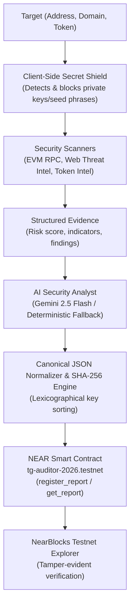

# TrustGuard AI

> **Decentralized Threat Intelligence & Tamper-Evident Security Registry on NEAR Protocol**

TrustGuard AI is a Web3 security and threat-analysis platform that audits smart contracts, wallets, token contracts, and dApp websites, generating canonical cryptographic hashes anchored to the NEAR blockchain.

- **Live NEAR Testnet Contract:** [`tg-auditor-2026.testnet`](https://testnet.nearblocks.io/address/tg-auditor-2026.testnet)
- **Active Network:** NEAR Protocol (Testnet)
- **AI Engine:** Google Gemini 2.5 Flash (`@google/genai`) with Deterministic Rule-Based Fallback

---

## Key Capabilities

### 1. Multi-Vector Threat Scanners
- **EVM & Account Scanner:** Evaluates addresses for code execution capabilities, balance thresholds, and account anomalies using public RPC infrastructure.
- **Website & Phishing Detector:** Inspects dApp domains, URLs, and redirect patterns for punycode exploits, lookalike typosquatting, and known phishing threats.
- **Token Security Scanner:** Audits NEP-141 and token contracts for transfer tax traps, blacklist/freeze functions, and minting privileges.

### 2. AI Security Analyst (Hybrid Engine)
- Grounded in evidence produced by the threat scanners (target, score, category findings).
- Powered by **Google Gemini 2.5 Flash** for deep threat assessment and plain-English risk breakdowns.
- **Deterministic Fallback:** If `GEMINI_API_KEY` is not configured or API limits are encountered, TrustGuard seamlessly falls back to a deterministic, rule-based heuristics engine without interrupting the audit workflow.

### 3. Client-Side Secret Shield (Zero Key Custody)
- Pre-flight input validation actively screens for raw private keys (EVM 64-hex, NEAR ed25519) and BIP-39 mnemonic seed phrases (12/24 words).
- Detected secrets are blocked on the client side and never transmitted, logged, or stored.
- *Note:* TrustGuard implements strict client-side secret isolation; it does not utilize Zero-Knowledge (ZK) cryptographic proofs.

### 4. Canonical Cryptographic Hashing
- Security reports are sanitized of ephemeral UI timestamps.
- JSON keys are recursively sorted in lexicographical order to eliminate serialization variance.
- A deterministic SHA-256 digest is generated (`report_hash`), creating an immutable digital fingerprint of the audit evidence.

### 5. NEAR On-Chain Verification Registry
- Audit hashes are registered directly to the smart contract [`tg-auditor-2026.testnet`](https://testnet.nearblocks.io/address/tg-auditor-2026.testnet) on NEAR Testnet.
- Any party can independently verify whether an audit report matches the immutable hash recorded on the NEAR blockchain.

---

## Architecture Flow



---

## Truth-in-Advertising: Implemented Features vs Fallbacks

| Feature | Implemented Architecture | Current Behavior / Limitations |
| :--- | :--- | :--- |
| **NEAR Blockchain** | Live smart contract deployed on NEAR Testnet (`tg-auditor-2026.testnet`) | Operates on NEAR Testnet; Mainnet deployment is future roadmap |
| **AI Threat Analysis** | Google Gemini 2.5 Flash with scanner context grounding | Automatically falls back to deterministic rule engine when offline or no API key |
| **Secret Protection** | Client-side regex & heuristic pattern rejection (Zero Key Custody) | Rejects private keys before submission; does not use Zero-Knowledge proofs |
| **Overview Quick Scans** | Instant heuristic preview with structured scoring | Shows quick off-chain preview; full on-chain anchoring happens in NEAR Auditor |

---

## Quickstart

### Prerequisites
- Node.js 18+
- npm

### Installation
```bash
git clone <repository-url>
cd agy-demo
npm install
```

### Environment Configuration
Create a `.env.local` file in the root directory:
```bash
# NEAR Protocol Configuration
NEXT_PUBLIC_NEAR_CONTRACT_ID="tg-auditor-2026.testnet"
NEXT_PUBLIC_NEAR_NETWORK="testnet"
NEAR_NODE_URL="https://rpc.testnet.near.org"

# Optional: Gemini API Key for dynamic AI Security Analyst
# If omitted, TrustGuard automatically uses the deterministic heuristic engine
GEMINI_API_KEY=""
```

### Running Locally
```bash
npm run dev
```
Open [http://localhost:3000](http://localhost:3000) in your browser.

---

## Verification & Testing

### 1. Standalone Unit & Integration Suite
Runs 23 automated tests verifying canonical JSON serialization, avalanche effect, hash validation, address checks, secret protection, and NEAR testnet contract query handling without requiring a server:
```bash
npm test
```

### 2. Live Runtime End-to-End Tests
Executes full HTTP endpoint integration tests against a running Next.js instance:
```bash
# In terminal 1:
npm run dev

# In terminal 2:
npm run test:e2e
```

### 3. Type Checking & Production Build
```bash
npx tsc --noEmit
npm run build
```

---

## Smart Contract Reference

- **Account:** [`tg-auditor-2026.testnet`](https://testnet.nearblocks.io/address/tg-auditor-2026.testnet)
- **Network:** NEAR Testnet
- **Key Methods:**
  - `register_report({ report_hash, target, risk_score, risk_level })`
  - `get_report({ report_hash })`
