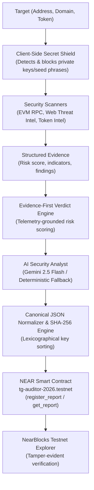

# TrustGuard AI

> **Decentralized Threat Intelligence & Tamper-Evident Security Registry on NEAR Protocol**

TrustGuard AI is a Web3 security and threat-analysis platform that audits smart contracts, wallets, token contracts, and dApp websites, generating canonical cryptographic hashes anchored to the NEAR blockchain.

- **Live NEAR Testnet Contract:** [`tg-auditor-2026.testnet`](https://testnet.nearblocks.io/address/tg-auditor-2026.testnet)
- **Active Network:** NEAR Protocol (Testnet)
- **AI Engine:** Google Gemini 2.5 Flash (`@google/genai`) with Deterministic Rule-Based Fallback

---

### The Problem & The Solution
- **The Problem:** Web3 users, protocols, and traders face rapid threat vectors—phishing domains, wallet drainers, and malicious token contracts—while traditional security audits are centralized, opaque, and vulnerable to post-incident tampering.
- **The Solution:** TrustGuard AI combines real-time multi-vector threat scanning with grounded AI reasoning, producing canonical SHA-256 digital fingerprints immutably anchored to the NEAR Protocol testnet for transparent, tamper-evident verification.

---

## Key Capabilities

### 1. Evidence-First Security Verdicts
- **Telemetry-Grounded Decision Engine:** Delivers structured risk verdicts (**SAFE**, **CAUTION**, or **DANGEROUS**) and an evidence confidence score, prioritizing verdicts grounded in verified scanner telemetry rather than unsupported AI-generated claims.
- **Transparent Indicator Matrix:** Displays verified threat indicators, technical risk factors, severity weightings, and direct on-chain verification badges.

### 2. Multi-Vector Threat Scanners
- **EVM & Account Scanner:** Evaluates addresses for code execution capabilities, balance thresholds, and account anomalies using public RPC infrastructure.
- **Website & Phishing Detector:** Inspects dApp domains, URLs, and redirect patterns for punycode exploits, lookalike typosquatting, and known phishing threats.
- **Token Security Scanner:** Audits NEP-141 and token contracts for transfer tax traps, blacklist/freeze functions, and minting privileges.

### 3. AI Security Analyst (Hybrid Engine)
- Grounded in evidence produced by the threat scanners (target, score, category findings).
- Powered by **Google Gemini 2.5 Flash** for deep threat assessment and plain-English risk breakdowns.
- **Multilingual Support:** Supports English, Hindi, and Hinglish for accessible Web3 security insights.
- **Deterministic Fallback:** If `GEMINI_API_KEY` is not configured or API limits are encountered, TrustGuard seamlessly falls back to a deterministic, rule-based heuristics engine without interrupting the audit workflow.

### 4. Client-Side Secret Shield (Zero Key Custody)
- Pre-flight input validation actively screens for raw private keys (EVM 64-hex, NEAR ed25519) and BIP-39 mnemonic seed phrases (12/24 words).
- Detected secrets are blocked before submission.
- *Note:* TrustGuard implements strict client-side secret isolation; it does not utilize Zero-Knowledge (ZK) cryptographic proofs.

### 5. Canonical Cryptographic Hashing
- Security reports are sanitized of ephemeral UI timestamps.
- JSON keys are recursively sorted in lexicographical order to eliminate serialization variance.
- A deterministic SHA-256 digest is generated (`report_hash`), creating an immutable digital fingerprint of the audit evidence.

### 6. NEAR On-Chain Verification Registry
- Audit hashes are registered directly to the smart contract [`tg-auditor-2026.testnet`](https://testnet.nearblocks.io/address/tg-auditor-2026.testnet) on NEAR Testnet.
- Any party can independently verify whether an audit report matches the immutable hash recorded on the NEAR blockchain.

---

## Architecture Flow



---

## Truth-in-Advertising: Implemented Features vs Fallbacks

| Feature | Implemented Architecture | Current Behavior / Limitations |
| :--- | :--- | :--- |
| **NEAR Blockchain** | Live smart contract deployed on NEAR Testnet (`tg-auditor-2026.testnet`) | Operates on NEAR Testnet; Mainnet deployment is future roadmap |
| **AI Threat Analysis** | Google Gemini 2.5 Flash with scanner context grounding | Automatically falls back to deterministic rule engine when offline or no API key |
| **Secret Protection** | Client-side regex & heuristic pattern rejection (Zero Key Custody) | Rejects private keys before submission; does not use Zero-Knowledge proofs |
| **Overview Quick Scans** | Instant heuristic preview with structured scoring | Shows quick off-chain preview; full on-chain anchoring happens in NEAR Auditor |

---

## Quickstart

### Prerequisites
- Node.js 18+
- npm

### Installation
```bash
git clone https://github.com/Prince145652/TrustGuard-AI.git
cd TrustGuard-AI
npm install
```

### Environment Configuration
Create a `.env.local` file in the root directory:
```bash
# NEAR Protocol Configuration
NEXT_PUBLIC_NEAR_CONTRACT_ID="tg-auditor-2026.testnet"
NEXT_PUBLIC_NEAR_NETWORK="testnet"
NEAR_NODE_URL="https://rpc.testnet.near.org"

# Optional: Gemini API Key for dynamic AI Security Analyst
# If omitted, TrustGuard automatically uses the deterministic heuristic engine
GEMINI_API_KEY=""
```

### Running Locally
```bash
npm run dev
```
Open [http://localhost:3000](http://localhost:3000) in your browser.

---

## Verification & Testing

### 1. Standalone Unit & Integration Suite
- **85/85 tests passed across 28 suites** via tsx test runner (`npm test`):
  - Canonical JSON serialization & lexicographical sorting
  - Cryptographic avalanche effect & SHA-256 validation
  - Zero-key client secret shield (regex & BIP-39 rejection)
  - Safe RPC timeouts & fail-closed inconclusive handling
  - Live activity store deduplication & in-memory transaction hash caching
  - Rate limiting anti-spoofing & fail-closed capacity limits
```bash
npm test
```

### 2. Live Runtime & Mobile E2E Tests
- **10/10 end-to-end tests passed** (`npm run test:e2e`), verifying:
  - Full API endpoints (`/api/scan/*`, `/api/near/*`, `/api/analyst/*`)
  - Browser-level responsive mobile viewport verification at **360px**
```bash
# In terminal 1:
npm run dev

# In terminal 2:
npm run test:e2e
```

### 3. Type Checking & Production Build
- **TypeScript:** Passed with 0 errors (`npx tsc --noEmit`)
- **Turbopack Build:** Clean production build with 10 static pages & 6 dynamic API routes (`npm run build`)
```bash
npx tsc --noEmit
npm run build
```

---

## Production Hardening & Anti-Abuse

- **Anti-Spoofing Rate Limiter:** Validates client IP via strict `TRUSTED_PROXY` mode (`none`, `cloudflare`, `nginx`, `fly-io`, `vercel`) with shared fallback bucket (`direct-client`) to defeat header-spoofing attacks.
- **Fail-Closed Capacity Protection:** Prevents memory exhaustion attacks by failing closed (HTTP 429) without evicting active rate-limit records.
- **API Error Sanitization:** Sanitizes upstream RPC and AI errors to prevent credential or internal topology leakage.
- **Zero Key Custody:** Client-side regex and mnemonic detection strictly reject private keys and seed phrases before network transit.

---

## Smart Contract Reference

- **Contract Account:** [`tg-auditor-2026.testnet`](https://testnet.nearblocks.io/address/tg-auditor-2026.testnet)
- **Network:** NEAR Protocol Testnet
- **Explorer:** [View on NearBlocks](https://testnet.nearblocks.io/address/tg-auditor-2026.testnet)
- **Core Contract Interface (`contracts/trustguard-registry/src/lib.rs`):**
  - **Mutations (Authorized Relayer):**
    - `register_report(report_id, report_hash, target, risk_score)` — Anchors canonical SHA-256 hash and metadata with deduplication checks.
  - **Public Read Queries (No Wallet Required):**
    - `verify_report(report_hash)` — Verifies on-chain existence of an audit hash.
    - `get_report(report_hash)` — Fetches full record (block height, timestamp, risk score, registrar).
    - `get_report_by_id(report_id)` — Fetches audit record by unique report ID.
    - `get_total_reports()` — Returns total anchored audits counter.
